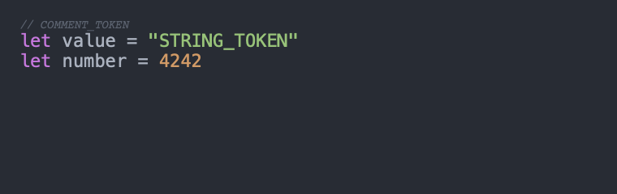
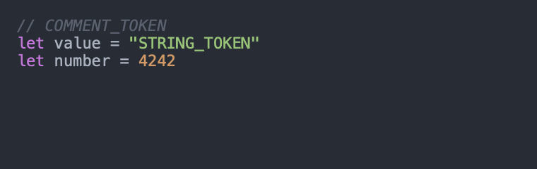
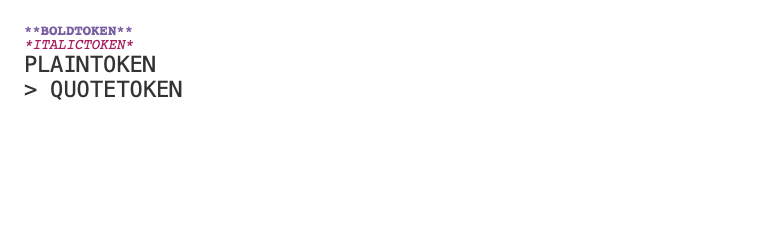
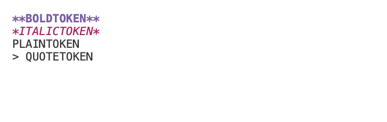

# Styled syntax fonts

Built-in syntax highlighting must use the selected code font's size and family.
This includes the 22-point minimum used by carousel exports. Bold/italic variants
are requested from that family when available.

Highlightr 2.3.0 builds styled font attributes when it loads a theme. Assigning
`theme.codeFont` changes the base font without refreshing those attributes, so
styled tokens can retain the initial Courier 14-point font. Its `setCodeFont`
method refreshes the bold/italic variants and the theme dictionary together.

The regression covers One Dark, One Light, and GitHub at 14 and 22 points. Swift
exercises comments, keywords, identifiers, strings, and numbers; Markdown exercises
bold, italic, plain text, and quotations. Alphanumeric Markdown markers avoid
accidentally introducing emphasis with underscores. Menlo is used so the test
needs no font installation, license, application preferences, or clipboard.

## Reproduce the regression

Use a separate checkout at base commit
`62d7d570a4799e587d4f6a9c6be99cfa2ff3914e`, and copy only
`RenderingTests/StyledTokenFontTests.swift` from this change into it. Do not revert
an active working checkout. Run the same commands below on the base and the fix:

```sh
make project
output="$(mktemp -d "${TMPDIR:-/tmp}/vitrine-styled-fonts.XXXXXX")"
env SWT_EXPERIMENTAL_MAXIMUM_PARALLELIZATION_WIDTH=1 \
  DEVELOPER_DIR=/Applications/Xcode.app/Contents/Developer \
  xcodebuild -project Vitrine.xcodeproj -scheme VitrineRendering \
  -configuration Debug -destination 'platform=macOS' \
  -derivedDataPath "$output/DerivedData" \
  -resultBundlePath "$output/styled-fonts.xcresult" \
  -enableCodeCoverage NO -parallel-testing-enabled NO \
  -only-testing:VitrineRenderingTests/StyledTokenFontTests \
  CODE_SIGNING_ALLOWED=NO test
```

Requirements are the repository's full Xcode 26+ and pinned XcodeGen 2.46.0.
`make project` verifies the pinned Sparkle archive; project dependencies remain
Highlightr 2.3.0 and KeyboardShortcuts 2.4.0. This is a hostless rendering test;
it does not launch the Vitrine app or request UI automation permissions.

On the base, the selected-family assertions fail, and 22-point styled tokens
also fail the point-size assertion. On the fix, the same assertions must pass
while Markdown bold and italic traits remain present. No scheduler, progress,
cache-key, palette, permission, or output-publication behavior is changed.

## Inspect the rendered samples

The second test records two synthetic 760×240 PNG attachments through the real
SwiftUI renderer and PNG encoder. They show One Dark Swift and GitHub Markdown,
with Menlo selected at 22 points. No image-store or user-content input is needed.

```sh
DEVELOPER_DIR=/Applications/Xcode.app/Contents/Developer \
  xcrun xcresulttool export attachments \
  --path "$output/styled-fonts.xcresult" \
  --output-path "$output/attachments"
```

Use the exported manifest to locate `styled-fonts-one-dark-swift.png` and
`styled-fonts-github-markdown.png`. Compare the same samples from the base and the
fix. The comments/emphasis should follow the selected size and family, rather
than retaining Courier 14. Rendered samples are evidence of syntax output, not a
native application UX or accessibility qualification.

The local diagnostic environment is arm64 macOS 27.0.1, Xcode 27.1 (27A9275),
Swift 6.4, and Highlightr 2.3.0. Required macOS 15/26 CI remains authoritative.
Existing strict goldens may reflect the old styled glyphs; inspect qualified
CI-generated candidates before changing any baseline. Do not overwrite goldens
merely to obtain a passing comparison.

## Before and after

These synthetic samples come from the attachment test above; both select Menlo
22 points. They contain no desktop capture or application data. Ancillary EXIF
metadata was removed for publication without changing the compressed pixel data.

| Fixture | Base | Fix |
| --- | --- | --- |
| One Dark / Swift |  |  |
| GitHub / Markdown |  |  |

Local before/after validation with the same final test source: the base produces
33 font-attribute assertion failures across six theme/size cases. After the API
change, both tests pass, including all six parameter combinations and both PNG
attachments. The complete hostless Rendering suite passes 57 tests in 13 suites.
These results establish font propagation and representative rendered output;
they do not establish application launch speed or full interactive UI behavior.

## Qualified golden review

CI run [40113045302](https://github.com/johnny4young/vitrine/actions/runs/40113045302)
passed the functional/coverage and performance suites on macOS 15 and 26. The
strict Tahoe golden comparison detected the corrected glyphs in all six export
fixtures. The social card remained byte-identical. The automatically recorded
candidate artifact `golden-candidates-tahoe-26` (artifact ID `12568056583`) was
reviewed before refreshing the six export PNGs and their dimensional records.

The candidate and previous manifest pin exactly the same arm64 macOS 26.6.2
(25G83), Xcode 17F113, SDK 25F70 and Swift 6.2 environment. Every scenario
fingerprint is unchanged. Default/light/transparent exports grow from 848×556 to
848×564, and the selected-line export grows from 848×612 to 848×620, reflecting
the selected font's line metrics. Line numbers remain 848×620 and OpenGraph
remains 1200×630. All six before/after pairs were visually reviewed for complete
text, chrome, gutters and highlight placement. No comparison tolerance or
qualification check is relaxed.

The bundled JetBrains Mono asset is Regular only. When a selected family lacks
an available bold/italic face, Highlightr falls back to that family's regular
face. In these golden samples the comment is therefore upright; preserving the
selected family/size does not promise synthesized italics or bundle additional
font faces. The Menlo regression separately verifies bold/italic variants that
are available. This limit is visible in the reviewed images.

[Golden provenance and per-file hashes](highlight-font-golden-review.json) retain
the source commit, run, artifact digest, exact environment and dimensions. To
retrieve the same public CI candidate artifact while it remains available:

```sh
gh run download 40113045302 --repo johnny4young/vitrine \
  --name golden-candidates-tahoe-26 --dir "$output/qualified-candidates"
```

The refreshed references still need a new strict CI comparison. A recorded
candidate alone is not a passing comparison receipt.
